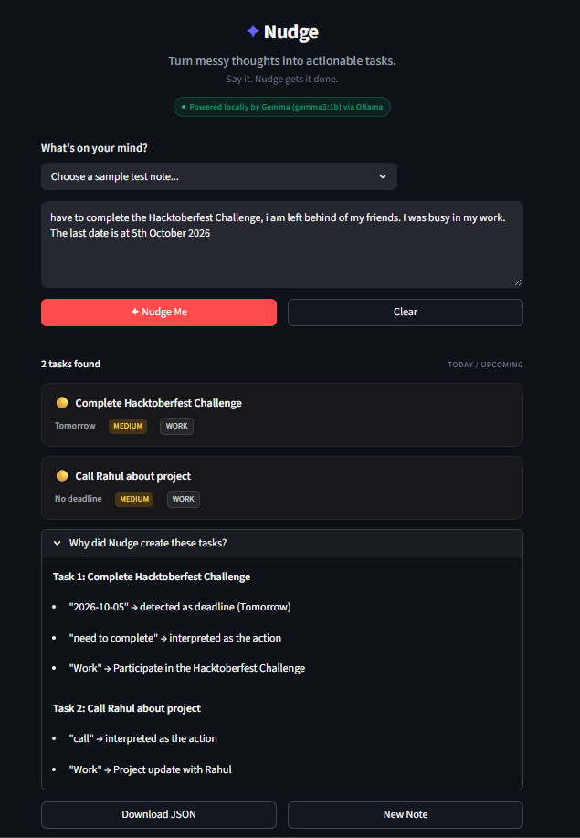

# Nudge — Turning Messy Thoughts Into Action

This is a submission for the [Hacktoberfest Weekend Challenge: Build for a Friend](https://dev.to/challenges/hacktoberfest-weekend-2026-10-01).

---

## What I Built

I built **Nudge**, a small local-first AI assistant for a friend who often has multiple things to remember but keeps them buried inside messy notes and messages.

Instead of manually organizing those thoughts, they can simply write something naturally, such as:

> *"Tomorrow I need to finish my DBMS assignment, call Rahul tonight about the project, and pay Ahmed ₹500 on Friday."*

Nudge uses an open-weight AI model to understand the note and turn it into clear, actionable tasks with deadlines, priorities, and categories.

For example:

- 🔴 **Finish DBMS assignment** — Tomorrow — High — College
- 🟡 **Call Rahul about the project** — Tonight — Medium — Personal
- 🔴 **Pay Ahmed ₹500** — Friday — High — Finance

The goal isn't to build another complicated productivity app. It's to remove the friction between thinking about something and actually turning it into an action.

---

## Demo



- 🎥 **Video Demo**: [Watch on YouTube](https://youtu.be/Gp_h3yUaJh0)

The demo shows a messy natural-language note being processed locally and transformed into structured tasks.

---

## Code

- 💻 **GitHub Repository**: [mohammedabidali1956/Nudge-Hacktoberfest-2026-Build-for-a-Friend-Challenge](https://github.com/mohammedabidali1956/Nudge-Hacktoberfest-2026-Build-for-a-Friend-Challenge)

The project is intentionally small and focused so the core AI workflow is easy to understand and reproduce.

---

## How I Built It

Nudge is built around **Gemma**, Google's open-weight model, running locally through **Ollama**.

The core pipeline is:

```text
User's Note ──▶ Nudge (Streamlit) ──▶ Ollama ──▶ Gemma 3 (1B) ──▶ Structured JSON ──▶ Actionable Tasks
```

The application uses **Python** and **Streamlit** for the interface and communicates directly with the locally running Ollama instance.

Gemma is responsible for the heavy lifting: understanding natural language, identifying individual actions, interpreting relative deadlines such as *"tomorrow"* or *"Friday"*, assigning priorities, and categorizing tasks.

For example:

> *"Tonight call Rahul and tomorrow submit the DBMS assignment."*

becomes structured task data rather than a generic AI response.

The project deliberately keeps the architecture simple so that the AI is the product's core capability rather than an added chatbot feature.

---

## Why Does Open Innovation Matter?

For Nudge, local open-weight AI is not just a technology choice. It changes how the product can be used.

A friend's notes can contain personal information, plans, payments, relationships, and other private details. With Nudge's local-first architecture, those notes do not have to be sent to a proprietary cloud AI API.

Instead:

```text
Friend's Computer ──▶ Nudge ──▶ Ollama ──▶ Gemma
```

Everything needed for the AI processing runs directly on the local machine.

This also makes the AI layer more flexible. Because Nudge uses an open-weight model through Ollama, the model can be swapped or upgraded without rebuilding the entire application around a closed provider.

Most importantly, open AI made it possible to build something private, reproducible, and genuinely useful on a personal computer, rather than requiring users to trust a third-party AI service with their everyday thoughts.

---

## Prize Categories

### 🏆 Best Use of Gemma

Nudge is built around **Gemma** as its core natural-language understanding engine. Gemma performs the task extraction, deadline interpretation, prioritization, and categorization that make the application useful.

The challenge lists **Best Use of Gemma** as a dedicated partner category.

---

## Quickstart & Local Setup

### 1. Prerequisites

Ensure [Ollama](https://ollama.com/) is installed and running with `gemma3:1b`:

```bash
ollama serve
ollama pull gemma3:1b
```

### 2. Set Up Environment & Install Dependencies

```bash
# Clone the repository
git clone https://github.com/mohammedabidali1956/Nudge-Hacktoberfest-2026-Build-for-a-Friend-Challenge.git
cd Nudge-Hacktoberfest-2026-Build-for-a-Friend-Challenge

# Create virtual environment (optional but recommended)
python -m venv venv

# Windows
venv\Scripts\activate

# macOS / Linux
source venv/bin/activate

# Install requirements
pip install -r requirements.txt
```

### 3. Run the App

```bash
streamlit run app.py
```

Open `http://localhost:8501` in your browser. No API keys or cloud credentials required!
